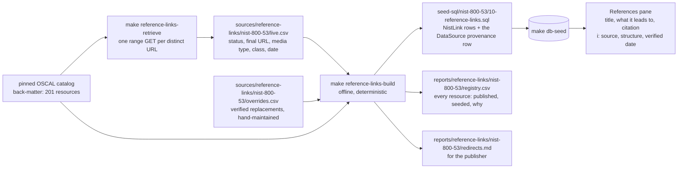

# Reference links

Paths below are relative to `app/prisma/`: inputs live under `sources/`, this pipeline's code under `generators/`, its reports under `reports/`, and the seed under `seed-sql/`.

The catalog cites its references in its own bibliography, the OSCAL back-matter: 201 resources, each with a title, a citation and one URL, cited by 219 of the 1,014 live controls. This pipeline seeds those links for the References pane of each control, at each resource's **current** location rather than the one the pinned catalog publishes, and keeps the provenance of every row beside the seed. The catalog is pinned and its URLs age: at the current pin one resource in twenty is dead or has moved, including OMB A-130, the most cited resource of all.

## The process

Two commands, run from the repository root:

- `make reference-links-retrieve` is the only step that touches the network. It reads every back-matter URL from the catalog, requests each distinct one once, and writes `sources/reference-links/nist-800-53/live.csv`. Review the diff: it is the record of what changed on the web since the last pull.
- `make reference-links-build` is offline. It reads the catalog, `live.csv` and `overrides.csv`, resolves each resource to the URL the seed carries, checks the gates, and writes the seed file and the two reports. The same three inputs always produce byte-identical files.

`make reference-links` runs both. Then `make db-seed` loads the seed, and the References pane shows the result. The runbook for a refresh, written for maintainers and for the owners of the sites linked to, is `docs/runbooks/refresh-reference-links.md`; the reasoning behind the design is `docs/architecture/reference-links.md`.

## Files

| Path                                                | Role                                                                                                                                                                                                                                                                                                                        | Written by                                                         |
| --------------------------------------------------- | --------------------------------------------------------------------------------------------------------------------------------------------------------------------------------------------------------------------------------------------------------------------------------------------------------------------------- | ------------------------------------------------------------------ |
| `sources/reference-links/nist-800-53/live.csv`      | One row per distinct catalog URL: `url`, `status`, `final_url`, `content_type`, `class`, `error`, `checked_on`. The date on every row is the date of that pull.                                                                                                                                                             | `retrieve.ts`; committed                                           |
| `sources/reference-links/nist-800-53/overrides.csv` | A verified replacement for a catalog URL that is gone: `source_url`, `replacement_url`, `reason`, `verified_on`. Seven rows today.                                                                                                                                                                                          | a person, after confirming the replacement in a browser; committed |
| `seed-sql/nist-800-53/10-reference-links.sql`       | The seed: a `DataSource` row recording the retrieval (name, the catalog pin as its URL, `lastCrawled` = the check date, a one-sentence description) and one `NistLink` row per control citation with the title, the seeded URL, the citation as description, the resolved URL, the media type, and the provenance row's id. | `build.ts`; committed                                              |
| `reports/reference-links/nist-800-53/registry.csv`  | Every resource: the published URL, the seeded URL, the resolved URL, the media type, the resolution and the reason, the live status, class and date, the override date, and the controls citing it.                                                                                                                         | `build.ts`; committed                                              |
| `reports/reference-links/nist-800-53/redirects.md`  | What the publisher would need to change, grouped: gone with a verified replacement, redirects, gone with none, could not be verified by a script. Written to be submitted upstream as it is.                                                                                                                                | `build.ts`; committed                                              |

The folder is laid out per corpus (`sources/reference-links/<corpus>/`, `reports/reference-links/<corpus>/`) so a second corpus, such as the CISA Zero Trust guidance pages, slots in beside the NIST catalog without restructuring.

## The resolution rule

For each resource, in this order:

1. A row in `overrides.csv` wins: the seed carries the replacement, and the registry records the reason and the date it was verified.
2. A URL whose live class is `reachable` and whose final URL differs from the published one is seeded at the final URL, so a retired path is never served. The exception is a DOI, whose whole point is to be the stable name: it is kept, and the resolved URL records where it lands.
3. A URL whose class is `script-blocked` or `tls-chain` is seeded as published and flagged for a manual check: the host refused a scripted client, or served a certificate chain a browser repairs and Node does not.
4. A URL whose class is `gone` or `unreachable` with no override is not seeded, so every seeded URL passes `make check-seed-links`, and it stays in `redirects.md` until a replacement is found and added to `overrides.csv`.

## Gates

`build.ts` writes nothing unless every declared expectation holds, in the NIST generator's style: floors measured at the pin (195 resources with a link, 780 reference links on live controls, 770 seeded) and zero-ceilings for a resource without a link, a reference to an unknown resource, a citing control without a label, a catalog URL with no live result (the message says to run the retrieval), an override that names no catalog URL, and a seeded URL with a format defect. Resources held out are capped at ten and named.

## What the retrieval does to a site

One `GET` per distinct URL asking for the first byte (`Range: bytes=0-0`), redirects followed, four requests in flight at most with a 300 ms pause between them, one retry after a timeout or a dropped socket, a 20 s timeout, and a client string that names this tool: `Mozilla/5.0 (compatible; decoder-ring-link-check/1.0)`. No crawling, no sitemap reads, no body downloads except one page on a host with a known soft-404 signature. It runs on demand, not on a schedule. The link checker that does the probing is `app/scripts/check-links/`; its doc is `docs/scripts/check-links.md`.
