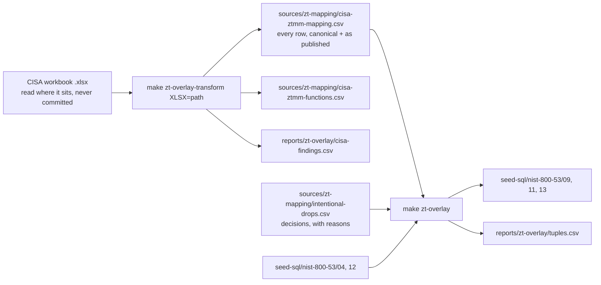

# Zero Trust overlay

Paths below are relative to `app/prisma/`: inputs live under `sources/`, this pipeline's code under `generators/`, its reports under `reports/`, and the seed under `seed-sql/`.

The Zero Trust overlay is what the Zero Trust pane shows for a control: the pillars, functions and maturity levels it supports. This pipeline builds it for the NIST SP 800-53 Rev. 5 catalog from CISA's control mapping of its Zero Trust Maturity Model, as CISA published it. A tuple leaves it only through a decision recorded with a reason.

It writes three seed files into `seed-sql/nist-800-53/`:

- `09-zt-mappings.sql`: one `ZeroTrustMapping` per mapped control, with a representative (pillar, function, maturity) that resolves to a guidance row.
- `11-zt-part-coverage.sql`: one `ZTPartCoverage` per statement item a mapping covers. CISA maps whole controls and names no statement item, so this file has no rows; it stays so every catalog seeds the same files.
- `13-zt-mapping-affinity.sql`: one `ZTMappingAffinity` per (pillar, function, maturity) tuple, which drives the per-tuple guidance.

## The process

Two commands, run from the repository root:

- `make zt-overlay-transform XLSX=<path>` reads the workbook and writes the CSV the generator reads. Run it when CISA publishes a new edition; review the CSV's diff, which is the record of what CISA changed.
- `make zt-overlay` is offline and deterministic. It folds CISA's rows into tuples, checks that every row lands, and writes the three seed files and the tuple report. The same inputs always produce byte-identical files, on any machine whatever its locale, and `__tests__/data.test.ts` fails if the committed seed and a fresh regeneration differ.

Then `make db-seed` (with `CATALOG=nist-800-53`, the default) loads it, and `scripts/check-seed-sql.py --catalog=nist-800-53` checks that every mapping resolves to a guidance row. `yarn zt:generate` without `--write` writes a review copy beside the script; `reports/zt-overlay/tuples.csv` shows every tuple's rows, designations and fate.

## The source

CISA's Zero Trust Initiative mapped the maturity model to NIST SP 800-53 Rev. 5 with a group of agencies: workbook "CISA Draft ZTMM Control Mapping (FINAL).xlsx", read 2026-10-09. Its "Control Mapping" sheet has one row per control mapped to one pillar and function at one maturity floor: 632 rows on 345 controls, all of them in the Rev. 5 catalog. The workbook defines its designations:

- **Key:** directly provides the function or mechanism to meet the maturity level for the target function.
- **Supporting:** enhances the function; enables or assists with meeting it.
- **Informative:** defines or directs how the function should be implemented.
- **If Applicable:** applies only when the control is relevant to the system's scope (the capability does not exist in the system, or the control is managed by another party or inherited).

It leaves out the Governance function of each pillar, as untestable in its review, and maps no control to the three capabilities standing alone.

### Reading it safely

The workbook is outside input. `lib/xlsx.ts` inflates only the four parts a sheet's values need, each under a size cap; refuses any part that declares a DTD, so no entity it defines is expanded; never evaluates a formula, taking the value the workbook cached; and never opens external links, document properties or embedded media. The workbook's own metadata (authoring paths, labels) is not read and reaches no output.

### What the transform changes

| Published                                              | Seeded                                                    | Rule                                                                 |
| ------------------------------------------------------ | --------------------------------------------------------- | -------------------------------------------------------------------- |
| `AC-2(1)`                                              | `AC-02(01)`                                               | the shared identifier rule, `shared/control-identifier/canonical.ts` |
| `Device`, `Network`, `Application`, `Identity`, `Data` | `DEVICES`, `NETWORKS`, `APPLICATIONS`, `IDENTITY`, `DATA` | the schema's pillar enum                                             |
| `Traditional+`, `Initial+`, `Advanced+`, `Optimal`     | `TRADITIONAL`, `INITIAL`, `ADVANCED`, `OPTIMAL`           | "+" means this level and above, which one enum value already says    |
| a function name                                        | the name in the sheet's function-code table               | `FUNCTION_GROUPS` in `lib/cisa.ts`, per pillar                       |

A function is seeded under the name CISA's sheet gives it in its own function-code table (`sources/zt-mapping/cisa-ztmm-functions.csv`): 32 functions across the five pillars, the in-pillar capabilities carrying the pillar's name ("Device Visibility and Analytics"). The guidance seed (`12-ztmm-guidance-updated.sql`) names its groups the same way, so a mapping resolves by CISA's name and nothing translates between the two. Two spellings the sheet uses outside its own table are read as the table's name, and recorded as findings:

| Pillar       | Published                      | Seeded                                   |
| ------------ | ------------------------------ | ---------------------------------------- |
| Applications | Application Threat Protections | Application Threat Protection            |
| Applications | Automation and Orchestration   | Application Automation and Orchestration |

A pair not in the table stops the run, and so does a pair read as a name the code table lacks.

### What it keeps

Nothing in the sheet is dropped. `sources/zt-mapping/cisa-ztmm-mapping.csv` has every row, repeats included, keyed by `source_row` (the sheet's row number), and every column the sheet carries:

| Column                                                                                                       | Holds                                                             |
| ------------------------------------------------------------------------------------------------------------ | ----------------------------------------------------------------- |
| `source_row`                                                                                                 | the sheet row                                                     |
| `control_id`, `pillar`, `function`, `maturity`                                                               | the seeded values                                                 |
| `designation`, `if_applicable`                                                                               | as published (`if_applicable` as yes/no); seeded on each tuple    |
| `function_transform`                                                                                         | "as published", or what changed                                   |
| `cisa_control_id`, `cisa_pillar`, `cisa_function`, `cisa_maturity`                                           | as published, verbatim                                            |
| `cisa_function_code`                                                                                         | the sheet's four-digit code for the function, from its code table |
| `cisa_multiple_pillars`, `cisa_pillar_duplicate_id`, `cisa_multiple_functions`, `cisa_function_duplicate_id` | the sheet's analysis columns, verbatim                            |
| `cisa_control_name`, `cisa_control_text`                                                                     | as published                                                      |

The three analysis columns the sheet computes by formula are recomputed by the transform and must equal what the workbook cached, so a stale workbook stops the run. `sources/zt-mapping/cisa-ztmm-functions.csv` is the sheet's function-code table.

### What looks wrong in it

`reports/zt-overlay/cisa-findings.csv` lists what a person should look at, none of it fatal. From this edition, 41 findings:

- four repeated rows (AC-02, AC-06, SC-08, SC-28), and AC-06's pair disagrees: Key on one, Supporting on the other;
- three controls with one function at two maturities (CA-07(04), RA-03, SC-05(03)), kept as two tuples;
- 17 rows whose function has a trailing space, one of which (IA-02, row 276) therefore lost its function code;
- 13 rows naming a function outside the sheet's own list: "Application Threat Protections" (7) and a bare "Automation and Orchestration" (6, on CM-08 and its enhancements, and CM-09);
- SC-12(02), row 458: "Appears in Multiple Pillars", typed by hand, says "-" for a control that appears twice;
- CM-02 and SI-02 are each named in two capitalisations.

Outside the sheet: the Instructions sheet's code list gives Data Automation and Orchestration 0506, the code of Data Visibility and Analytics; the sheet's own code table, which the formulas use, gives 0507.

## How the rows become tuples

A tuple is (control, pillar, function, maturity). CISA rows that repeat a tuple fold into it, and their rows, designations and If Applicable flags are kept on it.

The representative tuple in `09` is the first of: a tuple that resolves to a guidance group, then the strongest designation CISA gives it (Key, then Supporting, then Informative; a tuple folded from several rows takes the best), then the lowest maturity, then the function name, then the model's pillar order. Its pillar leads the control's pillar list, because the read path resolves guidance by (first pillar, function).

`reports/zt-overlay/tuples.csv` has one row per tuple: kept or dropped, whether it is its control's representative, whether it resolves to a guidance group, and CISA's rows, designations and If Applicable flags for it, with the reason beside a dropped one.

### Removing something on purpose

`sources/zt-mapping/intentional-drops.csv` is the only way a tuple leaves the overlay: `control_id, pillar, function, maturity, reason, decided_by, decided_on`. A drop must name a tuple CISA maps and must give a reason; the tuple report shows the reason beside the dropped row. It is empty: the overlay is CISA's mapping as published, and what looks wrong in the source is recorded in the findings rather than corrected.

### The gate

The run stops, writing nothing, unless every CISA row is in the output or in the drop list; every control is in the catalog seed (`04`); and no two different tuples share an affinity id. The declared expectations then hold the counts at or above what the inputs promise.

## What the counts mean

Measured 2026-10-21. Every number is printed by `make zt-overlay` and can be filtered out of `reports/zt-overlay/tuples.csv`.

- **345 mapped controls**, every one in the Rev. 5 catalog.
- **628 tuples** from 632 rows: four rows repeat another row exactly (AC-02, AC-06, SC-08, SC-28) and fold into it. By pillar: Applications 152, Data 149, Devices 106, Identity 80, Networks 141.
- **Designations**, per row: Key 215, Supporting 302, Informative 115. If Applicable is set on 129 rows.
- **Designations**, per tuple, as `13` seeds them: Key 212, Supporting 301, Informative 115, a tuple folded from several rows taking the strongest. If Applicable is set on 129 tuples, and a folded tuple carries it only when every row does. The modal shows both on each tuple.
- **0 covered items.** The mapping is control-level.

## Open questions

- The 41 findings in `reports/zt-overlay/cisa-findings.csv` are kept as published, for CISA's Zero Trust team to correct in a later edition.

## Files

| Path                                       | Role                                                                                                                                        | Written by                  |
| ------------------------------------------ | ------------------------------------------------------------------------------------------------------------------------------------------- | --------------------------- |
| `transform.ts`                             | workbook → `sources/zt-mapping/cisa-ztmm-mapping.csv`, `sources/zt-mapping/cisa-ztmm-functions.csv`, `reports/zt-overlay/cisa-findings.csv` | —                           |
| `generate.ts`                              | inputs → `09`, `11`, `13` and `reports/zt-overlay/tuples.csv`; `--write` targets the seed directory                                         | —                           |
| `lib/xlsx.ts`                              | the workbook reader                                                                                                                         | —                           |
| `lib/cisa.ts`                              | the transform: column contract, `FUNCTION_GROUPS`, findings                                                                                 | —                           |
| `lib/overlay.ts`                           | the tuples, drops, reconciliation, representative choice, SQL                                                                               | —                           |
| `lib/report.ts`                            | the tuple report and run summary                                                                                                            | —                           |
| `lib/order.ts`                             | the orderings every sort uses, the same on every machine                                                                                    | —                           |
| `sources/zt-mapping/cisa-ztmm-mapping.csv` | CISA's mapping                                                                                                                              | `make zt-overlay-transform` |
| `sources/zt-mapping/intentional-drops.csv` | removal decisions                                                                                                                           | a person                    |
| `reports/zt-overlay/tuples.csv`            | every tuple's rows, designations and fate                                                                                                   | `make zt-overlay`           |
| `reports/zt-overlay/cisa-findings.csv`     | what looks wrong in the source                                                                                                              | `make zt-overlay-transform` |
