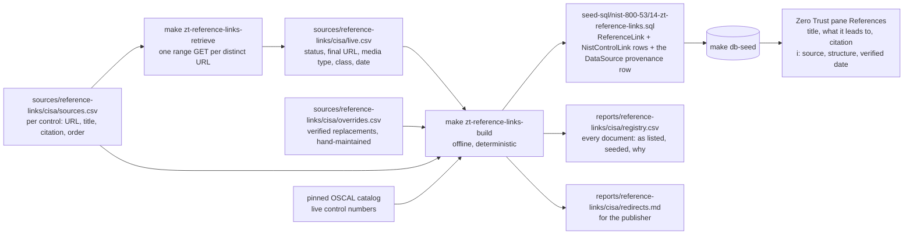

# Zero Trust reference links

Paths below are relative to `app/prisma/`: inputs live under `sources/`, this pipeline's code under `generators/`, its reports under `reports/`, and the seed under `seed-sql/`.

The Zero Trust pane of each control has a References section of its own, separate from the references the catalog cites. This pipeline seeds those links: Zero Trust references mapped per control, first from CISA's Zero Trust Maturity Model and the guidance CISA publishes around it, each seeded at the document's **current** location and with the provenance of every row beside the seed. Different controls carry different references; a document is stored once and attached to every control that cites it, in the order listed. Every row follows from a tuple in CISA's control mapping of the model: the maturity model's page for a function CISA gives the control; OMB M-22-09 at the section of its representative pillar, and at the Appendix B task-matrix page where the matrix names the control; the microsegmentation guide at the page that addresses the control; and the SASE and TIC 3.0 guide where it has traffic encryption. That is 604 rows on all 345 controls CISA maps, across 28 distinct URLs. The 212 controls that had none carry the maturity model's page for every function CISA gives them; 47 controls mapped before that rule cite some of their pages, or M-22-09 alone. A row no CISA tuple supports is deleted rather than kept. An unmapped control has no tuple to cite from and shows the empty state.

## The process

Two commands, run from the repository root:

- `make zt-reference-links-retrieve` is the only step that touches the network. It reads every URL in the sources table, requests each distinct one once, and writes `sources/reference-links/cisa/live.csv`. Review the diff: it is the record of what changed on the web since the last pull.
- `make zt-reference-links-build` is offline. It reads the sources table, `live.csv`, `overrides.csv` and the pinned catalog, resolves each document to the URL the seed carries, checks the gates, and writes the seed file and the two reports. The same four inputs always produce byte-identical files.

`make zt-reference-links` runs both. Then `make db-seed` loads the seed, and the Zero Trust pane shows the result. The runbook for a refresh, written for maintainers and for the owners of the sites linked to, is `docs/runbooks/refresh-reference-links.md`; the reasoning behind the design is `docs/architecture/reference-links.md`.

## Files

| Path                                             | Role                                                                                                                                                                                                                                                                                                                               | Written by                                                         |
| ------------------------------------------------ | ---------------------------------------------------------------------------------------------------------------------------------------------------------------------------------------------------------------------------------------------------------------------------------------------------------------------------------- | ------------------------------------------------------------------ |
| `sources/reference-links/cisa/sources.csv`       | The references, one row per (control, document): `control_number`, `url`, `title`, `citation`, `display_order`. The table is the authority; everything else is derived from it.                                                                                                                                                    | a person; committed                                                |
| `sources/reference-links/cisa/live.csv`          | One row per distinct listed URL: `url`, `status`, `final_url`, `content_type`, `class`, `error`, `checked_on`. The date on every row is the date of that pull.                                                                                                                                                                     | `retrieve.ts`; committed                                           |
| `sources/reference-links/cisa/overrides.csv`     | A verified replacement for a listed URL that is gone: `source_url`, `replacement_url`, `reason`, `verified_on`. Empty until one is needed.                                                                                                                                                                                         | a person, after confirming the replacement in a browser; committed |
| `seed-sql/nist-800-53/14-zt-reference-links.sql` | The seed: a `DataSource` row recording the retrieval (name, the corpus home page as its URL, `lastCrawled` = the check date, a one-sentence description), one `ReferenceLink` row per document with its title, seeded URL, citation, domain and kind, and one `NistControlLink` row per (control, document) with the listed order. | `build.ts`; committed                                              |
| `reports/reference-links/cisa/registry.csv`      | Every document: the listed URL, the seeded URL, the resolved URL, the media type, the resolution and the reason, the live status, class and date, the override date, and the controls citing it.                                                                                                                                   | `build.ts`; committed                                              |
| `reports/reference-links/cisa/redirects.md`      | What the publisher would need to change, grouped: gone with a verified replacement, redirects, gone with none, could not be verified by a script. Written to be submitted upstream as it is.                                                                                                                                       | `build.ts`; committed                                              |

The folder is laid out per corpus (`sources/reference-links/<corpus>/`, `reports/reference-links/<corpus>/`) so a second Zero Trust publisher slots in beside CISA without restructuring. The catalog's own references live in the sibling pipeline `../reference-links/`, whose resolver, CSV codec and provenance writer this one imports.

## Adding a row

Before adding a row, check three things. The build checks none of them: it sorts each link as NIST, other federal or external and accepts all three.

- The source is published by CISA, OMB or NIST.
- The link is at page or section level: a `#page=N` or section anchor on a longer document.
- `control_number` is the control the page or section supports.

Adding one is a row in `sources.csv` and `make zt-reference-links`. The retrieval records a result for each listed URL, anchor included, and the build looks a document up by its full URL, so a new `#page=N` on an address already checked still needs the retrieval: `make zt-reference-links-build` alone leaves that row unseeded and fails the build. Every control CISA maps carries at least one row, and `../zt-overlay/__tests__/reference-coverage.test.ts` fails when one does not: the test sits with the overlay, since this pipeline's boundary keeps it from naming the overlay's files.

- `control_number` is the control as the catalog labels it, zero-padded: `AC-02`, `AC-02(01)`. The build refuses a number the catalog does not carry live, so a withdrawn control cannot take a link.
- `url` is the address as published, with a `#page=N` anchor where the reference is one section of a longer document. Each anchored URL is its own stored document, and the retrieval requests the address once however many anchors cite it. The anchor's number is the PDF viewer's page, which is what the link opens; the title's `(p. N)` and the citation's page carry the document's own printed number. The two coincide for the maturity model and the memo and differ by four for the SASE and microsegmentation guides. The build seeds the current location; a redirect is followed and recorded, and a gone address is a row to fix or to override, never one to hold out.
- `title` is the document's own name. `citation` is the publisher, the document and its date. A document is stored once, so it has one title and one citation however many controls cite it: the first row for a document stands for it, and a later row that disagrees fails the build. What a document says to a particular control belongs in that control's guidance, not in the citation.
- `display_order` is 1-based and unique within a control. It is the order the pane renders.

## References maintained by hand

The references beyond this table, CISA, NIST and OMB guidance cited at the page or section that addresses a control, are maintained by hand in their own seed files, one per publisher: `seed-sql/nist-800-53/17-zt-references-nist.sql`, `18-zt-references-cisa.sql` and `19-zt-references-omb.sql`. No generator or table writes them; each file is its own source, and its header carries the rules below. They seed after `14`, into the same `ReferenceLink` and `NistControlLink` tables, so the pane shows each control's generated references first and then these, in file order.

Every row meets the acceptance rule:

1. The document is published by CISA, OMB or NIST.
2. The address opens a specific page or section (a PDF `#page=N` anchor or a section heading anchor), not a landing page.
3. The row names a control the page or section addresses, and the document entry says in one sentence what that page or section covers. A document is stored once per address, so the sentence describes the page, not why one control cites it; a tie specific to one control comes from citing the page that addresses it.
4. The link check passes on the address.

Only controls in the CISA mapping take a row; `../zt-overlay/__tests__/reference-coverage.test.ts` fails on any other. To add one:

1. In the publisher's file, add a documents entry for a new address (the address, a title naming the document, section and printed page, the one-sentence description, and the domain by host), or reuse an address another file already seeds.
2. Add an attachments entry per control: the control id as the catalog seeds it (`ctrl_ac-03_r520`, `ctrl_ac-03_07__r520`), the address, and its position among the rows that file gives the control. A wrong control id, an address with no entry or a pair already seeded fails the seed instead of being skipped.
3. Check it: `make check-seed-links SEED_FILES=<file>` probes the file's addresses live, `make ci-check-links` checks every seed file's format, and `make db-seed` loads it. Set the file's `DataSource.lastCrawled` to the date of the check, in UTC as the retrieval stamps its own: the pane reports the oldest check across its reference files.
4. Commit the file and open a pull request.

## The resolution rule

For each document, in this order:

1. A row in `overrides.csv` wins: the seed carries the replacement, and the registry records the reason and the date it was verified.
2. A URL whose live class is `reachable` and whose final URL differs from the listed one is seeded at the final URL, so a retired path is never served; a page anchor on the listed URL is carried onto the target, since the server never saw it and the place it names moved with the document. The exception is a DOI, which is kept as the stable name with the resolved URL recorded.
3. A URL whose class is `script-blocked` or `tls-chain` is seeded as listed and flagged for a manual check: the host refused a scripted client, or served a certificate chain a browser repairs and Node does not.
4. A URL whose class is `gone` or `unreachable` with no override fails the build. In the registry's `reason` column, "catalog URL" means the URL as listed.

## Gates

`build.ts` writes nothing unless every declared expectation holds, in the catalog generator's style: floors measured at the table's current size (604 rows on 345 controls, every control CISA maps) and zero-ceilings for a row naming a control the catalog does not carry live, a duplicate (control, URL) pair, a display order repeated or not positive, an empty title, a URL listed with more than one title or citation, a listed URL with a format defect or with no live result (the message says to run the retrieval), an override that names no listed URL or whose replacement is gone, a document not seeded, two listed documents resolving to one seeded URL (which the conflict clause would silently merge), and a seeded URL with a format defect.

## What the retrieval does to a site

The same as the catalog pipeline's retrieval, with the same client string: one `GET` per distinct URL asking for the first byte, redirects followed, four requests in flight at most with a 300 ms pause, one retry, a 20 s timeout, no crawling, no sitemap reads, on demand only. The full statement is in `../reference-links/README.md` under the same heading.
