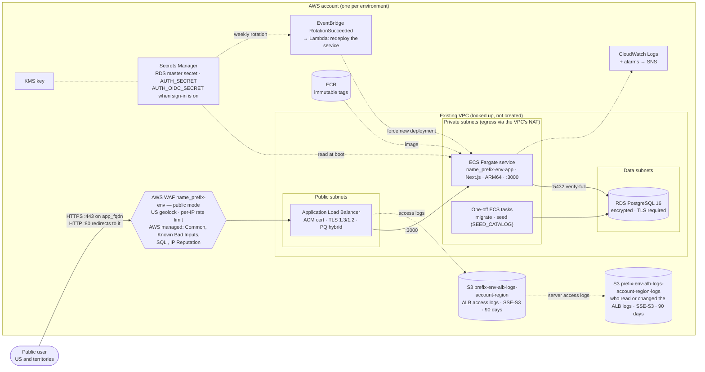

# AWS Deployment Architecture

Decoder Ring runs as one containerized Next.js service on ECS Fargate behind an Application Load Balancer, with RDS PostgreSQL behind it. Terraform in `infra/` deploys it into a fresh AWS account with an existing VPC. It builds the load balancer, Web ACL, access-log bucket, container service, database, secrets and alarms. It does not build the network: it finds the VPC by ID and the subnets by tag. The values that belong to one deployment are inputs that plan prompts for, not defaults: VPC, subnet prefix and hostname.

The deployment is public by default. Anyone in the United States or its territories reaches it through the Web ACL and the load balancer, with no VPN.



## Launching it

1. Bootstrap the account's state bucket once, in `infra/bootstrap/`. Every resource name starts with `<name_prefix>-<env>`: the ECR repository, cluster, service, task families, load balancer, Web ACL, database, roles, alarms and the `<name_prefix>/<env>/` secrets. A second instance in the same account and region takes a different `name_prefix` (default `ztdr`; 2 to 16 lowercase letters, digits and single hyphens, starting with a letter). S3 bucket names are global across every AWS account, so buckets add the account ID and region: `<name_prefix>-<env>-<purpose>-<account_id>-<region>`. With a non-default prefix, pass `NAME_PREFIX=<prefix>` to the `make` targets below. Use the same `name_prefix` in the bootstrap and the environment stack.
   - First apply on local state: `terraform init`, then `terraform apply -var environment=<env>` (add `-var name_prefix=<prefix>` to change it).
   - Save output `backend_config` as `backend-<env>.hcl` and move the state into the bucket: `terraform init -migrate-state -backend-config=backend-<env>.hcl`, then delete the local `terraform.tfstate*`.
   - Save output `environment_backend_config` as `infra/environments/<env>/backend.hcl`. Neither file is committed; each directory carries a `.example`.
2. In `infra/environments/<env>/`, run `terraform init -backend-config=backend.hcl`, then `terraform plan`. It prompts for `vpc_id`, `subnet_name_prefix` and `app_fqdn`, or takes them from a gitignored `*.auto.tfvars` or `TF_VAR_<name>`.
   - The subnets are found by Name tag `<subnet_name_prefix>-{public,private,data}-*`, at least two of each.
   - `app_fqdn` is a hostname in a DNS zone you control, such as `decoderring.example.gov`. It is the app's only address: the app is served over HTTPS on it and nowhere over plain HTTP.
3. Apply. Output `launch` gives:
   - the URL;
   - the hostname format;
   - the DNS records to publish: the hostname's alias or CNAME to the ALB, and the certificate's validation CNAMEs;
   - the remaining steps;
   - the WAF posture;
   - sign-in: anonymous, or the redirect URI and the client-secret command.
4. Push the image, then create and load the database. The first apply creates the ECR repository `<name_prefix>-<env>` empty and the database with no schema, and both are filled before step 5 starts the service. With `AWS_PROFILE` set to this account:
   - Build, check, scan and push the tag in `container_image_tag`: `make ecr-build-push IMAGE_TAG=<container_image_tag> ENV=<env>`. Tags are immutable, so a rebuild needs a new tag in `terraform.tfvars` and another apply. Runbook: [`build-and-push-image.md`](../runbooks/build-and-push-image.md).
   - Create the schema: `make ecs-run-migrate ENV=<env>`.
   - Load the catalog: `make ecs-run-seed ENV=<env>`. The seed replaces every catalog table, so it is safe to re-run and never merges with what was there. Runbook: [`ecs-migration-and-seed.md`](../runbooks/ecs-migration-and-seed.md).
5. Publish the records. Once the certificate is ISSUED, set `enable_https_listener = true` and apply again. That creates the HTTPS listener and starts the service on the pushed image; `GET /api/health` on output `launch.url` returns 200 once a task is healthy. Port 80 only ever redirects to HTTPS, so nothing serves the app before this step, and plan warns until it is done.
6. Optionally, sign-in: set `oidc_issuer` and `oidc_client_id` (and any of the optional `oidc_*` inputs) and apply. Register the redirect URI from `launch.sign_in` at the issuer, store the client secret with the command it gives, and the service redeploys with sign-in on. A configuration the app would refuse fails at `terraform plan`.

`terraform.tfvars.example` in each environment lists every input.

## Request path

- **WAF**: one Web ACL, `<name_prefix>-<env>`, chosen by `waf_mode`.
  - **`public`** (the default): allow by default. It blocks requests from outside `waf_allowed_country_codes`, which defaults to the United States, Puerto Rico, Guam, the US Virgin Islands, American Samoa, the Northern Mariana Islands and the US Minor Outlying Islands. It blocks a client IP over `waf_rate_limit` requests per five minutes (default 2,000), and answers 429 to one over `waf_export_rate_limit` requests to the export file route (default 100) or `waf_count_rate_limit` to the export page's count (default 1,000). It runs the AWS managed Common, Known Bad Inputs, SQL injection and IP Reputation rule groups.
  - **`allowlist`**: the same rules, then default-block except `waf_allow_cidrs`.
  - **`none`**: no Web ACL.
- **ALB**: internet-facing in the public subnets. Access logs go to the S3 bucket `<name_prefix>-<env>-alb-logs-<account_id>-<region>` under `alb/`. The bucket is versioned, blocks public access, accepts only TLS, accepts writes only under this account's log path, and expires logs after 90 days. Unless `alb_access_logs_force_destroy` is set, nobody, administrators included, can remove a log version before it expires: a delete or an overwrite leaves the earlier version, which is kept as long as the rest. Under the same condition, S3 Object Lock in governance mode also holds each log version for that period. The `-logs` bucket cannot take Object Lock, because S3 refuses it on a server access log destination. It uses SSE-S3, the only server-side encryption ALB log delivery supports. The bucket's own S3 server access logs, which show who read or changed the ALB logs, go to `<name_prefix>-<env>-alb-logs-<account_id>-<region>-logs` under `alb-logs/`, with the same retention: a fresh account has no central trail that would record those reads otherwise. Port 80 only redirects to HTTPS. With `enable_https_listener`, port 443 terminates TLS with the ACM certificate for `app_fqdn`. The policy is `ELBSecurityPolicy-TLS13-1-2-Res-FIPS-PQ-2025-09`: TLS 1.3 and 1.2, GCM-mode ECDHE ciphers only, and hybrid post-quantum (ML-KEM) key exchange for clients that offer it, on a FIPS 140-validated cryptographic module. The module's `tls_security_policy` input accepts only the `ELBSecurityPolicy-TLS13-1-3-FIPS-*` and `ELBSecurityPolicy-TLS13-1-2-Res-FIPS-*` policies, so it refuses any non-FIPS policy and any FIPS one that allows TLS 1.0, TLS 1.1 or a CBC suite. Health check: `GET /api/health`.
- **App**: one Fargate task per environment (256 CPU / 512 MiB, ARM64, no autoscaling). It runs in the private subnets with no public IP, and the deployment circuit breaker rolls back a failed release.
- **Database**: RDS PostgreSQL 16 on `db.t4g.micro`. It is single-AZ, encrypted, not publicly accessible, and has `rds.force_ssl` on. The master password is RDS-managed in Secrets Manager. Aurora is not used.

Security groups chain the tiers:

- The ALB accepts 80 and 443 from anywhere and sends only to the app, on 3000.
- The app accepts only the ALB, and sends 443 out and 5432 to the database.
- The database accepts only the app.

## Secrets and configuration

- **No stored connection string.** The task receives `DB_HOST`, `DB_PORT`, `DB_NAME` and `DB_SECRET_ARN`. `app/entrypoint.mjs` reads the master secret at boot and composes `DATABASE_URL` with `sslmode=verify-full` against the bundled RDS CA.
- **`AUTH_SECRET`** is a generated secret at `<name_prefix>/<env>/AUTH_SECRET`, injected as an ECS secret. Bumping `auth_secret_rotation_version` writes a new value and redeploys the service.
- **Rotation self-heals.** With `enable_rotation_auto_redeploy` on, the master secret rotates in a weekly window (`db_secret_rotation_schedule`). An EventBridge rule on `RotationSucceeded` then triggers a Lambda that forces a new deployment, so the task re-reads the secret. Runbook: [`secret-rotation-auto-redeploy.md`](../runbooks/secret-rotation-auto-redeploy.md).
- **Encryption:** a customer-managed KMS key encrypts `AUTH_SECRET` and the application log group, and the master secret in prod.
- **Sign-in:** off by default; the app is anonymous. Setting `oidc_issuer` and `oidc_client_id` (and optionally `oidc_display_name`, `oidc_signin_link`, `oidc_allowed_email_domains`, `oidc_allow_unverified_email`) turns it on. Terraform passes them to the task, sets `AUTH_URL` to the app's URL, and creates `<name_prefix>/<env>/AUTH_OIDC_SECRET` without ever holding its value. Output `launch.sign_in` gives the redirect URI to register and the command that stores the client secret. Mapping and rules: [Auth Strategy](auth-strategy.md).

## Schema and data

Migrations and seeding run as one-off ECS tasks from the same image:

- `<name_prefix>-<env>-migrate` runs `prisma migrate deploy`;
- `<name_prefix>-<env>-seed` loads the catalog named by `SEED_CATALOG` (default `nist-800-53`).

Run them with `make ecs-run-migrate ENV=<env>` and `make ecs-run-seed ENV=<env>`. The runbook is [`ecs-migration-and-seed.md`](../runbooks/ecs-migration-and-seed.md).

## Environments

Dev and prod are separate AWS accounts with separate state; nothing is shared. Both run the same modules at the same size. Prod differs in what protects data from mistakes:

|                               | Dev                       | Prod                     |
| ----------------------------- | ------------------------- | ------------------------ |
| RDS backups                   | 7 days, no final snapshot | 30 days, final snapshot  |
| RDS / ALB deletion protection | Off                       | On                       |
| Master secret key             | AWS-managed               | Customer-managed KMS key |
| `AUTH_SECRET` recovery window | 7 days                    | 30 days                  |

## Observability

Container and Lambda logs go to CloudWatch for 30 days, and ALB access logs go to S3. Each WAF rule publishes CloudWatch metrics and sampled requests.

Eight alarms notify the `<name_prefix>-<env>-alerts` SNS topic: ALB 5xx and unhealthy targets, RDS CPU and free storage, ECS running tasks and deployment rollbacks, rotation-redeploy errors, and a failed seed run (a log metric on `[seed-ecs] Failed`). Recipients come from `alarm_email_endpoints`, which is not committed.

## Terraform layout

- **`infra/bootstrap/`:** run once per account. It creates the state bucket (versioned, encrypted, public access blocked) and its access-log bucket, which uses SSE-S3 so log delivery works, accepts only TLS and keeps logs 90 days. That bucket is versioned, and nobody can remove a log version before it expires. Bootstrap also prints the backend config for itself and for the environment stack. Locking is S3-native (`use_lockfile`).
- **`infra/environments/<env>/`:** one stack per environment, with a partial backend: the bucket comes from a `backend.hcl` that is not committed, written from the bootstrap's output. Each commits a baseline `terraform.tfvars` of account-independent values and a `terraform.tfvars.example` of every input.
- **`infra/modules/`:**
  - `networking`: lookups and the DB subnet group;
  - `security`, `kms`, `database`, `secrets`;
  - `compute`: ALB, access logs, ACM, WAF, ECS, ECR, IAM, logs, rotation redeploy.

  The modules are called from the environment stacks and never applied directly. Community modules (`terraform-aws-modules/*`) are pinned to exact versions.

```bash
make check-deploy-safety ENV=dev   # refuses to roll the running image backwards
cd infra/environments/dev && terraform plan && terraform apply
```

## Not built here

Worth deciding per deployment, against the AWS production checklist:

- no VPC flow logs;
- one app task;
- no WAF logging (rule metrics and sampled requests only);
- no cache headers or CDN. The data changes only at seed time, so both would be cheap wins.

Each is a Terraform or application addition, not a configuration value.

## Related

- [Auth Strategy](auth-strategy.md)
- [Production deploy and rollback](../runbooks/prod-deploy.md)
- [Change or roll back the ingress WAF](../runbooks/waf-rollback.md)
