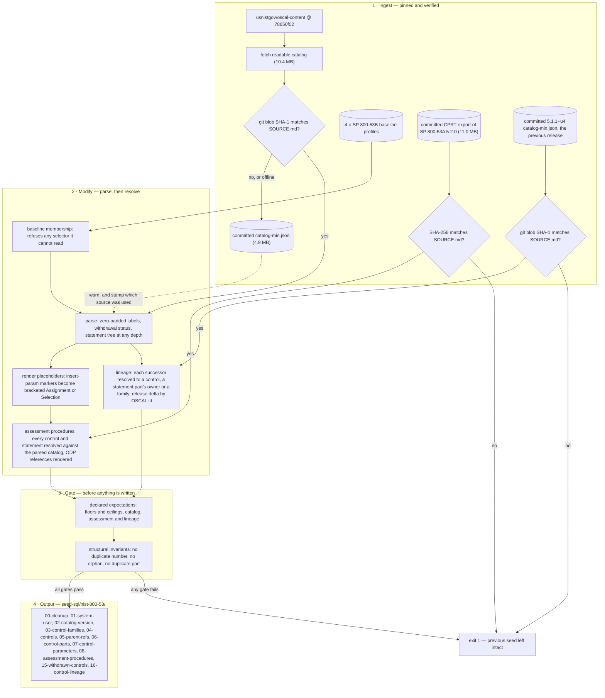

# generate-nist-seed — NIST SP 800-53 Rev 5 catalog to seed SQL

Reads the published NIST SP 800-53 Rev 5 OSCAL catalog and the four SP 800-53B baseline profiles, and writes the eight backbone seed files for Decoder Ring Standard. The same run reads the SP 800-53A Release 5.2.0 assessment procedures from the pinned CPRT export and writes them as a ninth file, `08-assessment-procedures.sql`, after the controls and parts they attach to. It writes the catalog's withdrawn controls to `15-withdrawn-controls.sql` and its lineage to `16-control-lineage.sql`: where each withdrawn control went, and which controls this release added or dropped against the previous one, read from that release's committed catalog. The catalog's own reference links are a separate pipeline (`app/prisma/generators/reference-links/`, which writes `10-reference-links.sql`). It imports nothing from any other generator, and a test enforces that; the reference-link and overlay pipelines import its expectations gate, ID scheme, parser and pin.

- Script: `app/prisma/generators/catalog/generate-seed.ts` (stages in the same directory)
- Make targets: none of its own; run it through `yarn seed:generate`, then `make db-seed CATALOG=nist-800-53`

## How a run flows



## Usage

```bash
# Generate into app/prisma/seed-sql/nist-800-53/
cd app && yarn seed:generate

# Skip the pinned fetch and use the committed copy
cd app && yarn seed:generate --offline

# Inspect a run before it touches tracked files
cd app && yarn seed:generate --out-dir /tmp/nist-seed

# Load the result
make db-seed CATALOG=nist-800-53

# Raw (what the yarn script wraps):
cd app && yarn tsx prisma/generators/catalog/generate-seed.ts
```

Flags: `--offline` skips the network entirely; `--out-dir <dir>` writes elsewhere, which is the safe way to inspect a run whose counts you do not trust yet; the directory must already exist.

## Reference links

The catalog's back-matter is seeded by its own pipeline, `app/prisma/generators/reference-links/` (README there, with a diagram), which writes `10-reference-links.sql` at each resource's current address from a committed live check. This generator does not read the back-matter. Refreshing the links is `docs/runbooks/refresh-reference-links.md`.

## Exit semantics

Exit 0 only when every declared expectation and every structural invariant holds. Any failure exits 1 **before a single file is written**, so a run that falls short leaves the previous seed on disk rather than replacing it with a thin one. The failure message names every bound that failed, not just the first, and says what was expected.

Five failures are hard errors rather than warnings, because each is silent otherwise:

- **A baseline profile using a selector the reader does not implement** — `matching`, `exclude-controls`, `include-all`, `with-child-controls`, or any unrecognised import key. The four pinned profiles use `with-ids` alone, so a reader that skipped an unknown construct would be correct today and wrong the moment the pin moved. It would also be wrong *quietly*: an ignored selector contributes no ids, so "listed equals resolved" still balances while membership under-counts.
- **A duplicate parameter id.** Parameter ids are globally unique in OSCAL; a duplicate means resolution would depend on traversal order.
- **A CPRT export whose SHA-256 is not the one `SOURCE.md` records.** There is no second copy to fall back to, so a rewritten pinned input stops the run rather than seeding from an input nobody can name.
- **A previous-release catalog whose blob SHA is not the one `SOURCE.md` records.** The release delta is only as true as the release it compares against, and there is no network copy to fall back to.
- **An assessment procedure attached to something the catalog did not seed.** Every control identifier in the export must be a control the catalog defines, and every control statement must translate to a seeded `ControlPart` id (`CST-AC-02-a` → `ac-2_smt.a`). A miss names the offenders and stops; a determination pointing at a part that does not exist is not a warning, it is the seed asserting something false.

The lineage gate declares, measured against the two pins: at least 195 successor rows (200 at the pin), exactly 11 withdrawn controls with several successors, no successor naming nothing in the catalog, no successor that is itself withdrawn (so every chain ends one step away), no withdrawn enhancement whose parent the catalog lacks (checked before any file is written), at most 2 withdrawn controls with no successor, at most one successor reached through a statement part and one naming a whole family, exactly 3 controls added since 5.1.1+u4 and none dropped. A new upstream withdrawal shape fails here by name rather than seeding a successor that leads nowhere.

The assessment gate declares, with floors measured at the pin: 2,790 determination statements (floor 2,700) with every live control carrying at least one; 2,931 method entries (floor 2,850) with at most 130 controls lacking a test method (108 at the pin, policy and procedure controls); every statement resolved; the four orphaned determinations and the IA-13 duplicate identifiers declared by name so any new upstream defect fails; every ODP reference rendered; no two determinations mapping onto one row id.

## Gotchas

**Drift warns rather than failing.** If the fetched catalog does not match the SHA recorded at the pin, or the network is unavailable, the run warns and falls back to the committed minified copy. That is a deliberate choice with a known cost — a warning nobody reads is how a stale pin ships — so the resolved source, its origin and its blob SHA are stamped into a `-- Source:` comment in **every generated file**. Which input produced a seed is answerable from the artifact, not from a log that scrolled away. Fetching the readable catalog and reading the committed minified one produce byte-identical output apart from that one line.

**Never let a formatter near `app/prisma/sources/nist-800-53/`.** Byte-identity *is* the provenance. `app/.prettierignore` excludes the pinned inputs because lint-staged once reformatted them and inflated the minified catalog from 4,906,119 to 9,538,362 bytes — nothing failed, the seed still parsed, and `SOURCE.md` was simply wrong about what had been ingested.

**Withdrawn controls seed apart from the live ones.** The 1,014 live controls go to `04` and the files that hang off it; the 182 withdrawn go to `15` with status `WITHDRAWN`, their number, title and parent, and nothing else, because the catalog carries no statement, parameters or baselines for them. They are kept out of `04` because the overlay reads that file at generation time to check its rows, and a withdrawn control is never one to map. They load after everything else so that `16`'s foreign keys resolve. Their successors go to `16` as `ControlLineage` rows keyed by control number, with foreign keys set wherever the related control is seeded. Succession is many-to-many: eleven withdrawn controls have more than one successor and two have none (CP-10(03), SC-19). Two successors are not controls: AC-02(10) names a statement part, `ac-2_smt.k`, which resolves to AC-02 and is kept as the item (`relatedPartOscalId`, with a key to its `ControlPart` row), and SA-12 names the SR family, which is kept as the code `SR` with no foreign key. Every read that lists controls (the layer cake, its roll-ups, search, the combined view) filters to live ones by default; `getControlById` serves a withdrawn control, and search includes them when asked. The model, what any source supplies for it and what a reader sees: [`docs/architecture/withdrawn-controls.md`](../architecture/withdrawn-controls.md).

**Part markers are kept as published.** NIST uses `a.` at the first level, `1.` at the second and `(a)` at the third, and the marker carries the nesting depth. The renderer adds a separator only when the catalog did not — reducing markers to a bare letter maps `a.` and `(a)` onto the same label and loses the third level.

**Moving the pin is deliberate work.** Update `PIN` and `EXPECTED_BLOB_SHA` in `fetch-inputs.ts`, re-download, record the new blob SHAs in `app/prisma/sources/nist-800-53/SOURCE.md`, and regenerate. A stale `EXPECTED_BLOB_SHA` only warns and stamps the seed "UNVERIFIED", so move both together. The pin is also the reference-link pipeline's provenance address, so rebuild `10` with `make reference-links-build`. The release the pin leaves becomes the previous one: commit its minified catalog in place of the current previous copy and move `PREVIOUS_PIN`, `PREVIOUS_CATALOG` and `PREVIOUS_BLOB_SHA` with it, so the delta compares adjacent releases. The expectation floors are measured against the current pin; if they fail afterwards, that is the gate working — read the delta before widening a bound. The CPRT export is pinned separately: re-fetch from the URL in `SOURCE.md`, record the new SHA-256 there and in `fetch-inputs.ts`, and regenerate.

**Assessment procedures come from a different publisher channel.** SP 800-53A is not in `oscal-content`; NIST publishes it through the Cybersecurity and Privacy Reference Tool (CPRT) in its own flat schema. The reader walks control → statement → determination projections and attaches each determination to the seeded part its statement translates to, or to the control when the statement is the root (single-block controls and most enhancements; the client sees that as a null `partId`). ODP references inside determinations (`<AC-02_ODP[01] prerequisites and criteria>`) render in the same bracket convention the catalog uses for parameters, so a determination and the statement it assesses read alike. Selections render their choices from the projected `odp_statement` because the reference text itself is the literal "SELECTED PARAMETER VALUE". Procedures for withdrawn controls (a one-line "Withdrawn" and a "[WITHDRAWN: Incorporated into ...]" determination) are counted and not emitted: they restate the control's status and successors, which `15` and `16` already carry.

## Expected output at the pin

20 families, 1,196 controls parsed, 182 withdrawn, 1,014 live (300 base and 714 enhancements), 2,136 statement parts, 1,600 parameters indexed, 902 of 902 baseline ids resolved, 1,204 placeholders rendered with none unresolved. Assessment procedures: 2,790 determination statements across all 1,014 live controls (1,713 attached to a lettered part, 1,077 to a control's root), 1,013 examine, 1,012 interview and 906 test entries, 1,743 ODP references rendered with none unresolved. Lineage: 182 withdrawn (24 base, 158 enhancements), 200 successor rows (166 incorporated into, 34 moved to) and 3 controls added since 5.1.1+u4 (SA-15(13), SA-24, SI-02(07)), 203 rows in all. Two consecutive runs are byte-identical.

## Related

- [`docs/architecture/data-pipeline.md`](../architecture/data-pipeline.md) — every seed file, the source it comes from and the generator that writes it.
- [`docs/architecture/withdrawn-controls.md`](../architecture/withdrawn-controls.md) — withdrawn controls and their lineage: the decisions, the model, what a source supplies, and what a reader sees.
- [`app/prisma/generators/zt-overlay/README.md`](../../app/prisma/generators/zt-overlay/README.md) — the Zero Trust overlay, which maps the catalog's controls to the maturity model.
- [`app/prisma/generators/reference-links/README.md`](../../app/prisma/generators/reference-links/README.md) — the catalog's own reference links.
- `app/prisma/sources/nist-800-53/SOURCE.md` — the pin, the per-file blob SHAs, and why JSON rather than XML or YAML.
